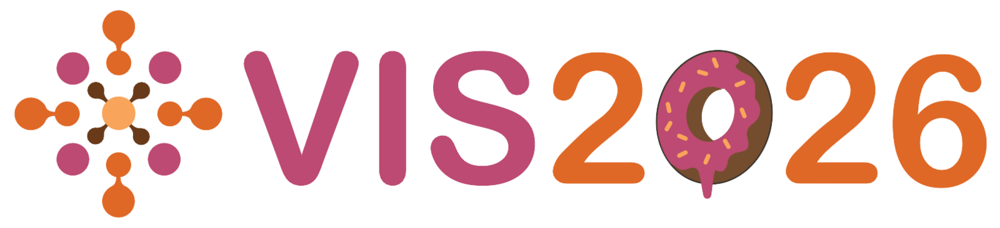

IEEE VIS 2026 is the premier forum for advances in theory, methods, and applications of visualization and visual analytics. This year&rsquo;s conference will be held November 9&ndash;13 in Boston, and EVL faculty and students will be there with papers, a poster, workshop and challenge presentations, a panel, and the kickoff of VIS 2027 in Chicago.

### Papers

Siyuan Zhao will present his VIS paper &ldquo;<a href="https://ieeevis.org/year/2026/program/content/a097f6a7-34fd-41c5-8f9e-42edbdf8efa0/">Loom: Multi-Region Analysis of Spatial Transcriptomics with Local Neighborhoods and Global Trajectories</a>&rdquo; in the paper session &ldquo;<a href="https://ieeevis.org/year/2026/program/session/v-full-full23/">What does it mean to live, anyway?</a>&rdquo; on Wednesday at 10:12am. 
Siyuan Zhao, Md Nafiul Alam Nipu, Hossein Fathollahian, Hao Chen, Ameen Salahudeen, Olga Karginova, G. Elisabeta Marai. 

Stefan Cobeli will present his TVCG paper &ldquo;<a href="https://ieeevis.org/year/2026/program/content/de762216-da09-4b32-8c29-d909c2c6338a/">A Neural Field-Based Approach for View Computation &amp; Data Exploration in 3D Urban Environments</a>&rdquo; in the paper session &ldquo;<a href="https://ieeevis.org/year/2026/program/session/v-full-full17/">Places and spaces</a>&rdquo; on Thursday at 1:36pm. 
Stefan Cobeli, Kazi Shahrukh Omar, Rodrigo Valença (Universidade Federal de Pernambuco), Nivan Ferreira (Universidade Federal de Pernambuco), Fabio Miranda. 

Kazi Shahrukh Omar will present his TVCG paper &ldquo;<a href="https://ieeevis.org/year/2026/program/content/1da6f750-8fe6-4cf4-8ccb-6b0b0fd097f7/">VIGMA: An Open-Access Framework for Visual Gait and Motion Analytics</a>&rdquo; in the paper session &ldquo;<a href="https://ieeevis.org/year/2026/program/session/v-full-full24/">Can we have a (real) doctor, please?</a>&rdquo; on Tuesday at 1:24pm. 
Kazi Shahrukh Omar, Shuaijie Wang (UIC Applied Health Sciences), Ridhuparan Kungumaraju, Tanvi Bhatt (UIC Applied Health Sciences), Fabio Miranda. 

### Workshops, challenges, and posters

On Monday morning, Khairi Reda will present &ldquo;<a href="https://arxiv.org/pdf/2608.07834">Marks, Channels, and Dead Ends: Stop Running Graphical Perception Studies and Start Modeling Visualizations as Images</a>&rdquo; at the <a href="https://ieeevis.org/year/2026/program/session/w-beliv-beliv-1/">BELIV&rsquo;26 workshop</a> (Evaluation and Beyond &ndash; Methodological Approaches for Visualization). 
Khairi Reda, S. Sharma, Luc Renambot, Fabio Miranda, Saeed Boorboor. 

On Monday at 3pm, Hossein Fathollahian will present &ldquo;<a href="https://ieeevis.org/year/2026/program/content/a6c83291-4e39-4455-b85a-62f4f2469531/">ConformaLens: Conformational States in Adaptive Molecular Dynamics</a>&rdquo; at the <a href="https://ieeevis.org/year/2026/program/session/c-biomedvis-challenge-biomedvis-challenge-1/">Bio+MedVis Challenge</a>. The work has been selected for "Award of Excellence". 
Hossein Fathollahian, Siyuan Zhao, Marziye Salahshour, Saeed Boorboor, G. Elisabeta Marai. 

Tahsen Islam Sajon will present &ldquo;<a href="https://ieeevis.org/year/2026/program/content/9044e003-36ee-4c64-a932-2ee823d1a19c/">LLM Agents for Visualization Generation and Vision-First Evaluation</a>&rdquo;, his runner-up entry in the AgenticVIS Challenge, at the <a href="https://ieeevis.org/year/2026/program/session/w-visxgenai-visxgenai-1/">VISxGenAI workshop</a> on Monday morning. 

Stefan Cobeli will also present the poster &ldquo;<a href="https://am.ieeevis.org/year/2026/program/content/37175365-7d7d-4de9-9987-50b55fa1678b/">Philosophical Lenses on Data Visualization</a>&rdquo; with Gustavo Moreira at the <a href="https://ieeevis.org/year/2026/program/session/conf-conference13/">Welcome Reception + Posters</a> on Tuesday at 6:30pm. 

Landon Dyken will present at the <a href="https://ieeevis.org/year/2026/program/session/c-doctorial-colloquium-c-doctorial-colloquium-1/">VIS Doctoral Colloquium</a> on Sunday, November 8. 

### Panel and conference service

On Tuesday at 1pm, Liz Marai will be a panelist in &ldquo;<a href="https://ieeevis.org/year/2026/program/session/v-panels-molecules-to-humankind-panel1/">Molecules to Humankind: Challenges in Multiscale Visualization</a>&rdquo;. Liz Marai is also co-chairing Area 2 of the VIS 2026 full papers. 

Saeed Boorboor is an organizer of the <a href="https://ieeevis.org/year/2026/program/session/w-visxgenai-visxgenai-1/">VISxGenAI: 2nd GenAI, Agents, and the Future of VIS</a> workshop on Monday morning. 

On Thursday at 4:30pm, the VIS 2027 General Chairs, Fabio Miranda, Victor Mateevitsi, Khairi Reda, and Michael E. Papka, will hold the <a href="https://ieeevis.org/year/2026/program/session/conf-conference9/">VIS 2027 Kickoff</a> session for VIS 2027 in Chicago, introducing the organizing committee and starting the conference preparation. 

Kazi Shahrukh Omar, Siyuan Zhao, and Hossein Fathollahian are <a href="https://vissv.github.io">student volunteers</a> at the conference. 

{:style="max-width: 100%"}

Link: [https://ieeevis.org/year/2026/welcome/](https://ieeevis.org/year/2026/welcome/)
