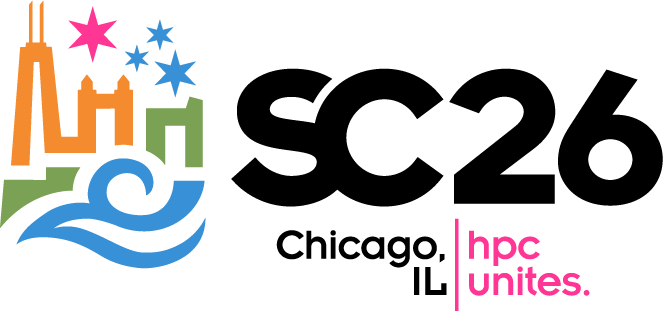

<a href="https://sc26.supercomputing.org/">SC26</a> is at McCormick Place in Chicago this year, November 15&ndash;20, and we are excited to have the supercomputing community in our own backyard. It is a short trip for our UIC students and Argonne colleagues, and a chance to show off the city.

With the conference in our home city, UIC has a strong showing. The EVL/HPC group and its collaborators are part of 21 papers and posters in the <a href="https://sc26.conference-program.com/">program</a>: a technical paper, 14 workshop papers, and six posters. UIC also has five pieces in the Art of HPC exhibition, which brings the total to 26 contributions at SC26.

### Technical paper

<ul>
<li><a href="https://sc26.conference-program.com/presentation/?id=pap521&amp;sess=sess223"><i>BitIR: Cross-Architecture Fault Injection for Resilience Analysis of Heterogeneous GPU Applications</i></a>, <b>Maisy Dunlavy</b>, Michael E. Papka, Zhiling Lan</li>
</ul>

### Workshop papers

<ul>
<li><a href="https://sc26.conference-program.com/presentation/?id=ws_ia139&amp;sess=sess115"><i>Accelerating GPU Datalog with Kernel Fusion</i></a> (IA3 2026), Ahmedur Rahman Shovon, Romain Pereira, Yihao Sun, Farhan Saif, Sidharth Kumar, Swann Perarnau</li>
<li><a href="https://sc26.conference-program.com/presentation/?id=ws_hust123&amp;sess=sess517"><i>AskALCF: A Self-Improving Agentic System for Intelligent HPC User Support</i></a> (HUST-26), Jingyan Jiang, Akhilesh Bondapalli, Krishna Rauniyar, Murat Keceli, Yasaman Ghadar, Haritha Siddabathuni Som, Venkatram Vishwanath, Michael E. Papka, Rong Ge, Huihuo Zheng</li>
<li><a href="https://sc26.conference-program.com/presentation/?id=ws_hpcoda102&amp;sess=sess153"><i>CQTwin: A Digital-Twin Toolkit for Operational Analytics of HPC Schedulers</i></a> (HPC-ODA), <b>Kanglin Xu</b>, <b>Yash Kurkure</b>, Yihe Zhang, Michael E. Papka, Zhiling Lan</li>
<li><a href="https://sc26.conference-program.com/presentation/?id=ws_ai4s130&amp;sess=sess114"><i>Distributed Volumetric Generation of Neuronal Morphology at Scale</i></a> (AI4S), <b>Jyotsna Rajaraman</b>, Thomas Uram, Mark Hereld, Michael E. Papka</li>
<li><a href="https://sc26.conference-program.com/presentation/?id=ws_ss101&amp;sess=sess157"><i>EcoShift: Performance-Aware Power Management for Power-Constrained Heterogeneous Systems</i></a> (Sustainable Supercomputing), <b>Zhong Zheng</b>, Michael E. Papka, Zhiling Lan</li>
<li><a href="https://sc26.conference-program.com/presentation/?id=ws_exampi107&amp;sess=sess143"><i>Execution-Path- and Restriction-Aware Autotuning for MPI Collective Operations</i></a> (ExaMPI26), <b>Kunting Qi</b>, Hui Zhou, Ke Fan, Michael E. Papka, Sidharth Kumar, Rajeev Thakur</li>
<li><a href="https://sc26.conference-program.com/presentation/?id=ws_eesp141&amp;sess=sess125"><i>Heterogeneous Energy Characterization of GPU-Powered Datalog Engines</i></a> (EESP 2026), Ahmedur Rahman Shovon, Yihao Sun, Zhiling Lan, Swann Perarnau, Thomas Gilray, Kristopher Micinski, Michael E. Papka, Sidharth Kumar</li>
<li><a href="https://sc26.conference-program.com/presentation/?id=ws_eesp109&amp;sess=sess125"><i>LASSI-EE: LLM-based Automated Refactoring of Parallel Scientific Codes for Energy Efficiency</i></a> (EESP 2026), Matthew T. Dearing, <b>Yiheng Tao</b>, Xingfu Wu, Zhiling Lan, Valerie Taylor</li>
<li><a href="https://sc26.conference-program.com/presentation/?id=ws_corr111&amp;sess=sess134"><i>LASSI-Verify: Adaptive Empirical Verification of LLM-Generated Parallel Scientific Code Transformations</i></a> (Correctness &rsquo;26), Matthew T. Dearing, Xingfu Wu, Zhiling Lan, Valerie Taylor</li>
<li><a href="https://sc26.conference-program.com/presentation/?id=ws_hpct102&amp;sess=sess155"><i>Mechanism-Aware Analysis of Cross-Platform GPU Fault-Injection Outcomes</i></a> (HPCTESTS 2026), <b>Maisy Dunlavy</b>, Michael E. Papka, Zhiling Lan</li>
<li><a href="https://sc26.conference-program.com/presentation/?id=ws_isav104&amp;sess=sess123"><i>N-VEG: 3D Gaussian Encoding for Neural Volume Compression</i></a> (ISAV26), Eero Dunham, Qi Wu, Landon Dyken, Victor Mateevitsi, Silvio Rizzi, Joseph Insley, Mengjiao Han, Janet Knowles, Michael E. Papka</li>
<li><a href="https://sc26.conference-program.com/presentation/?id=ws_aihpc107&amp;sess=sess141"><i>OPSERVE: Opportunistic LLM Inference over Fragmented GPU Capacity in HPC Systems</i></a> (AI on HPC), Patrick Watters, Xiaolong Ma, Harry Yu, Ian Foster, Michael E. Papka, Lei Yang, Feng Yan, Rajkumar Kettimuthu</li>
<li><a href="https://sc26.conference-program.com/presentation/?id=ws_pmbsf122&amp;sess=sess109"><i>PortWarp: A Cycle-Accurate GPU-Accelerated HPC Network Simulator Using Port-per-Thread Model</i></a> (PMBS26), Jun Tan, Boning Li, Kevin Brown, Zhiling Lan, Christopher Carothers</li>
<li><a href="https://sc26.conference-program.com/presentation/?id=ws_shpc107&amp;sess=sess126"><i>Towards Distributed-Memory All-Pairs Reachability over Homomorphically Encrypted Graphs</i></a> (Cyber Security in HPC), Charis Hulu, Anrin Chakraborti, Sidharth Kumar</li>
</ul>

### Posters

<ul>
<li><a href="https://sc26.conference-program.com/presentation/?id=rpost255&amp;sess=sess313"><i>Evaluating All-Reduce Operations in DDP Training with FABRIC: Framework for Architecture, Backend, and Reduction Interchange Comparison</i></a>, Matilde Restelli, Ke Fan, Aadirupa Saha, John Holmen, Sidharth Kumar</li>
<li><a href="https://sc26.conference-program.com/presentation/?id=rpost243&amp;sess=sess313"><i>Field-Preserving Gaussian Splatting for Interactive Visualization of Large-Scale Cosmological Simulations</i></a>, Md Robiul Islam, Mengjiao Han, Joseph Insley, Janet Knowles, Victor A. Mateevitsi, Michael E. Papka, Silvio Rizzi, Steve Petruzza</li>
<li><a href="https://sc26.conference-program.com/presentation/?id=src_post163&amp;sess=sess313"><i>Modeling and Verifying OpenMP Target Offloading Using CIVL</i></a>, Akshar Patel, Jan H&uuml;ckelheim, Zhiling Lan</li>
<li><a href="https://sc26.conference-program.com/presentation/?id=int_post103&amp;sess=sess313"><i>OpenCosmo Visualization: In-Browser Exploration of Cosmological Particle Data</i></a>, <b>Idunnuoluwa A. Adeniji</b>, Joseph Insley, Michael E. Papka</li>
<li><a href="https://sc26.conference-program.com/presentation/?id=rpost286&amp;sess=sess313"><i>Toward HEPScore4GPU: Scaling and Power of Real HEP GPU Applications on the A100 and H100</i></a>, <b>Smita Darmora</b>, Michael E. Papka</li>
<li><a href="https://sc26.conference-program.com/presentation/?id=rpost270&amp;sess=sess313"><i>VisKnacks: Agentic ParaView Visualization on HPC</i></a>, Nicholas Synovic, George K. Thiruvathukal, Manish Mathai, Mengjiao Han, Joseph Insley, Janet Knowles, Victor Mateevitsi, Silvio Rizzi, Michael E. Papka</li>
</ul>

### Art of HPC

All five pieces come from UIC.

On Wednesday, November 18, at 7:30pm, there is a special SC26 showing of <a href="https://artonthemart.com/art/argonne-national-laboratory-where-data-becomes-light"><em>Where Data Becomes Light: The Beauty of Scientific Visualization</em></a> on <a href="https://artonthemart.com/">ART on THE MART</a>. The projection, a collaboration between Argonne and UIC&rsquo;s Electronic Visualization Laboratory, covers the 2.5-acre river facade of THE MART and brings work from past SC Art of HPC exhibits and Scientific Visualization &amp; Data Analytics Showcases to the city&rsquo;s skyline.

<ul>
<li><a href="https://sc26.conference-program.com/presentation/?id=artc105&amp;sess=sess498"><i>Where Data Becomes Light: The Beauty of Scientific Visualization</i></a>, Michael E. Papka, Daria Tsoupikova, Zainab Ahmed, Beth Cerny, Joseph Insley, Farah Kamleh, Krystofer Kim, Janet Knowles, Victor Mateevitsi, Julie Parente, Silvio Rizzi, Laura Wolf</li>
<li><a href="https://sc26.conference-program.com/presentation/?id=artc101&amp;sess=sess498"><i>A Study of 4D Julia Sets: Iterations of Z = Z2 + K in the Quaternions</i></a>, Daniel Sandin</li>
<li><a href="https://sc26.conference-program.com/presentation/?id=art108&amp;sess=sess498"><i>Flow Through a Pebble-Bed Reactor in NekRS</i></a>, Victor Mateevitsi, Paul Fischer, Misun Min</li>
<li><a href="https://sc26.conference-program.com/presentation/?id=art119&amp;sess=sess498"><i>Fulfillment: Artistic Encounters with the Hidden Labor and Environmental Footprint of High Performance Computing</i></a>, Farah Kamleh, Darshan Shet, Gaeun Lee, Julie Chu, Daria Tsoupikova, Kenzell Huggins, Yanjun Long, Shahira Basha, Harini Kumar, Alexandria Schmidt</li>
<li><a href="https://sc26.conference-program.com/presentation/?id=art107&amp;sess=sess498"><i>Simulation of Tungsten Transport in the ASDEX-U Tokamak Plasma</i></a>, Victor Mateevitsi, Julien Dominski, Choong-Seock Chang, Joseph Insley</li>
</ul>

The work runs from resilience, power, scheduling, and MPI on leadership-class systems to agentic user support, LLM-driven code transformation, and new ways of seeing large scientific data, with the Art of HPC pieces carrying that work to a wider audience. Congratulations to the students presenting this week, and to everyone across EVL and UIC who made this showing possible.

{:style="max-width: 100%"}

Link: [https://sc26.supercomputing.org](https://sc26.supercomputing.org)
